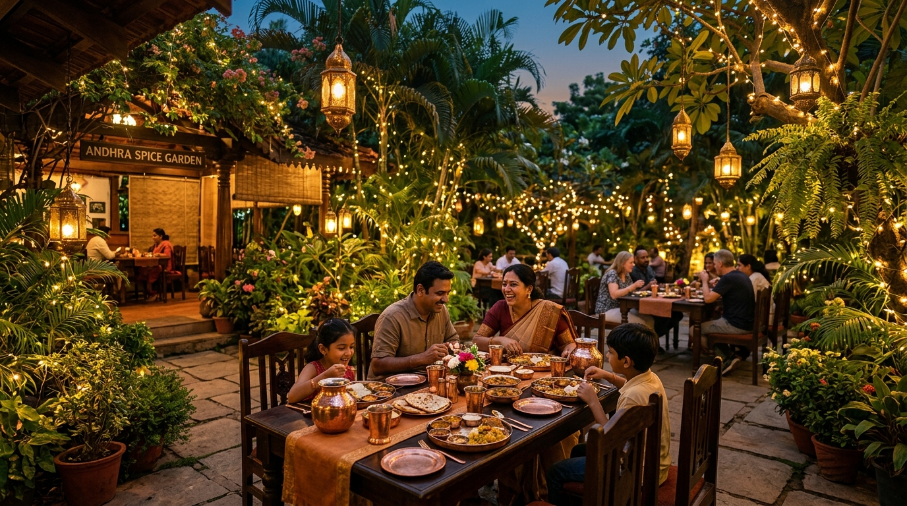

# ABHIRUCHI FAMILY RESTAURANT GARDEN

An inviting Indian dining garden website with the sophistication of a modern culinary destination, custom-designed for **ABHIRUCHI FAMILY RESTAURANT GARDEN** in Rayachoty, Andhra Pradesh.



---

## 🍽️ About the Restaurant

* **Name**: ABHIRUCHI FAMILY RESTAURANT GARDEN
* **Category**: Indian Family Restaurant
* **Location**: Madanapalli Rd, Kothapeta, Rayachoty, Andhra Pradesh 516269, India
* **Landmark**: Opposite Bharat Petrol Pump / Near Raju Colony, Madanapalli Road
* **Reported Rating**: 4.1 / 5.0 (380 reviews) from external public business directory
* **Dining Highlights**:
  * Family-friendly dining with open garden atmosphere
  * Private dining cabins for family privacy (subject to confirmation)
  * Signature favorites: **Abhiruchi Special Biryani** and **Chicken Grill**

---

## ✨ Features & Architecture

* **Visual Identity & Color Palette**:
  * Deep burgundy (`#481D26`) and dark wine (`#241116`)
  * Warm ivory (`#F8F3E9`) and parchment textures
  * Muted antique gold (`#C5A46D`) and soft sage (`#858D73`)
  * Display typography in **Cormorant Garamond** & interface typography in **Plus Jakarta Sans**
  * Handcrafted Indian Jali lattice background patterns (no generic AI dot grids)
* **Interactive Menu Explorer**:
  * Category tabs: Biryanis, Grills & Tandoori, Starters, Curries, Breads, and Desserts
  * Live instant search & Vegetarian-only toggle
  * Direct *"Ask Today's Specials"* WhatsApp channel
* **Photo Gallery & Lightbox**:
  * Editorial asymmetrical layout with category filters
  * Full-screen accessible modal lightbox with Next/Prev keyboard arrows & Esc dismissal
* **Table Reservation System**:
  * Indian 10-digit mobile number validation
  * Prevention of past-date bookings (`min={today}`)
  * Preferred time slot & seating selection (*Garden*, *Private Cabin*, *Main Hall*)
  * Automated WhatsApp reservation message generation with front-desk confirmation disclosure
  * Confetti celebration animation & session-saved booking log
* **Location & Directions**:
  * 1-Click Copy Full Address with visual confirmation feedback
  * Direct Google Maps turn-by-turn navigation button
  * Responsive interactive map embed
* **Accessibility & SEO**:
  * WCAG 2.2 AA compliant focus rings, semantic tags, and skip-to-content link
  * Schema.org JSON-LD LocalBusiness/Restaurant structured data
  * OpenGraph metadata, custom SVG favicon, and XML sitemap

---

## 🗂️ Project Structure

```
ABHIRUCHI/
├── public/
│   ├── images/              # Bespoke photography assets
│   ├── favicon.svg          # Custom brand emblem favicon
│   ├── robots.txt           # Search crawler directives
│   └── sitemap.xml          # SEO URL sitemap
├── src/
│   ├── components/
│   │   ├── AnnouncementBar.tsx       # Top notification bar with timing status
│   │   ├── Navbar.tsx                # Sticky blur navigation with active section indicator
│   │   ├── HeroSection.tsx           # Asymmetric hero with drifting light embers
│   │   ├── RestaurantHighlights.tsx  # Editorial trust strip & reported ratings
│   │   ├── StorySection.tsx          # "A Place to Come Together" narrative
│   │   ├── SignatureDishes.tsx       # Biryani and Chicken Grill spread
│   │   ├── MenuSection.tsx           # Filterable menu explorer with instant search
│   │   ├── ExperienceSection.tsx     # Family dining & private cabins highlight
│   │   ├── GallerySection.tsx        # Masonry photo gallery & interactive lightbox
│   │   ├── ReviewsSection.tsx        # External listing rating attribution
│   │   ├── ReservationSection.tsx    # Dedicated booking section
│   │   ├── ReservationForm.tsx       # Validated form with WhatsApp dispatch
│   │   ├── ReservationModal.tsx      # Accessible pop-up booking dialog
│   │   ├── LocationSection.tsx       # Address, 1-click copy, & Google Maps
│   │   ├── FAQSection.tsx            # Accessible spring accordion
│   │   ├── Footer.tsx                # Brand wordmark, legal, and privacy modal
│   │   ├── MobileActionBar.tsx       # Fixed bottom mobile action bar
│   │   ├── OwnerNoticeModal.tsx      # Pre-launch verification checklist for owner
│   │   └── ScrollProgressBar.tsx     # Antique gold reading progress bar
│   ├── data/
│   │   ├── restaurantConfig.ts       # Central business information & verification flags
│   │   ├── menuData.ts               # Dishes, categories, and dietary status
│   │   ├── galleryData.ts            # Photography captions and asset references
│   │   ├── reviewsData.ts            # External listing rating & guest quotes
│   │   └── faqData.ts                # FAQ questions and answers
│   ├── types/
│   │   └── index.ts                  # TypeScript data contracts
│   ├── App.tsx                       # Main page layout assembly
│   ├── index.css                     # Tailwind v4 theme, Jali patterns, & animations
│   └── main.tsx                      # Vite React entry point
├── package.json
└── vite.config.ts
```

---

## 🚀 Getting Started

### 1. Install Dependencies
```bash
npm install
```

### 2. Start Local Development Server
```bash
npm run dev
```
Open [http://localhost:5173](http://localhost:5173) in your browser.

### 3. Production Build
```bash
npm run build
```

---

## 📋 Owner Pre-Launch Checklist

Before launching on a public domain, the restaurant owner should verify the following values in `src/data/restaurantConfig.ts`:
1. **Phone & WhatsApp Number**: Set the active front-desk mobile number to receive customer reservation messages.
2. **Operating Hours**: Verify verified daily operating times (especially evening dinner hours).
3. **Menu & Pricing**: Update `src/data/menuData.ts` with complete printed dishes and current daily prices.
4. **Private Cabin Policies**: Confirm advance booking notice and cabin availability guidelines.
